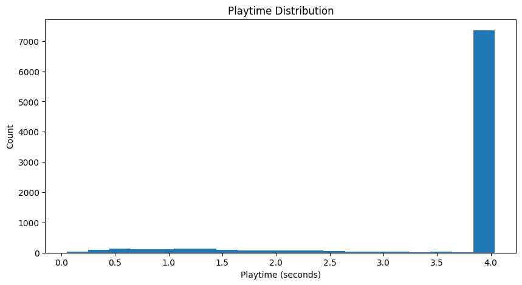
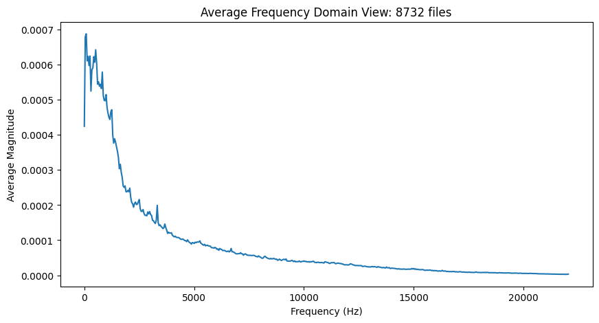

# P1 audit of UrbanSound8K, two-page summary

**Course:** IDIG4120 Digital Information Processing.
**Authors:** Katharina Kivle and Nikolai O. Stubø.

The full notebook, `IDIG4120_P1_Kivle_Stubø.ipynb`, stays as the extended
record with every table, plot and audio player. Every number below comes
from its run over the full release.

## The dataset

UrbanSound8K holds 8,732 WAV excerpts of urban sound, at most 4 seconds
each, in 10 classes (air_conditioner through street_music) and 10
predefined folds for cross-validation, plus one metadata CSV. We took it
from Kaggle on 2026-08-25 under CC BY-NC 4.0. Recording quality varies
across the collection, so the audit checks every file header against the
expected bit depth, channel count and sample rate before it counts
anything.
Nothing about this kind of audio raises a security concern.

## What the audit found

All 8,732 files load and decode, zero failures, and the CSV matches
every one of them. The encodings vary:

| Subtype | Files | Decodes to |
|---|---|---|
| PCM_16 | 5,758 | int16 |
| PCM_24 | 2,753 | int32 |
| FLOAT | 169 | float32 |
| PCM_U8 | 43 | uint8 |
| ADPCM (IMA and MS) | 9 | int16 |

Samples come out as arrays shaped `(frames, channels)`: 739 files mono,
7,993 stereo, averaging 173,864 frames. Amplitudes are normalized to full
scale, -1 to 1: integer PCM is mapped by its own range, and
floating-point samples pass through unchanged. On disk the release
weighs 6,760.26 MiB, about 812 kB a file. Sample rates vary from file to
file across 11 rates, 8,000 to 192,000 Hz with the mean near 48,457 Hz,
and nothing in this project ever resamples. Clips run up to 4 seconds,
3.61 on average, 8.75 hours in total.

The time view and the frequency view, both with labelled axes:

## Two experiments

**Quantisation to int16.** Our prediction: files at or below 16 bits
should come back bit-identical, their extra precision is false, and only
the 24-bit and float files should really change. That is what happens.
5,810 of 8,732 files (PCM_16, PCM_U8 and the ADPCM files) return RMSE
exactly 0. The 2,922 wider files move barely at all: mean RMSE 8.7e-6
for FLOAT and 8.2e-6 for PCM_24, the worst single file at 1.3e-5.
Converting everything to int16 cuts storage from 6,760.26 to 5,581.96
MiB, a 17.43% saving, and it fixes the baseline P2 measures against: P2
compresses int16 samples, so its ratios are measured against the 16-bit
PCM payload, not the on-disk byte size.

**Fourier pruning.** Our prediction: removing every coefficient below a
fraction of each channel's strongest component should shrink the sparse
representation, and the reconstruction error should grow slowly at first.
The sweep over all 873 fold1 files (769.76 MiB) confirms it:

| Threshold | Coefficients kept | Sparse size | Reduction | Mean RMSE |
|---|---|---|---|---|
| 0% | 100% | 1,226.69 MiB | -59.4% | 0.000000 |
| 0.1% | 42.3% | 530.32 MiB | 31.1% | 0.001115 |
| 0.5% | 22.2% | 281.05 MiB | 63.5% | 0.004980 |
| 1% | 15.6% | 199.13 MiB | 74.1% | 0.008920 |
| 2% | 10.0% | 128.90 MiB | 83.3% | 0.015431 |
| 5% | 4.4% | 57.44 MiB | 92.5% | 0.028621 |

One artefact is worth naming: at threshold 0 the sparse file is 59%
*larger* than the WAV, because storing indices and complex coefficients
costs more than the signal itself until pruning actually removes
something. Listened to at a 10% threshold, a clip keeping 0.85% of its
coefficients is still clearly recognizable. The notebook plays the
removed signal next to the reconstruction: what the error metric calls
negligible, RMSE 0.005, is plainly audible content. A file can pass every
structural check and still lose audible material, so the audit reports
both checks.

## Where the numbers come from

The loader (scipy as the primary decoder, soundfile as fallback, the CSV
optional) validates and measures every file in one pass over the release.
Rerunning it reproduces everything above.

Nikolai started P1 and Katharina reviewed the first part before we
finished the collaborated sections together. Katharina ran the
filtering experiment, Nikolai the quantisation. The generative-AI
declaration sits next to this document as
`IDIG4120-KI-Deklarasjon-P1.pdf`.
